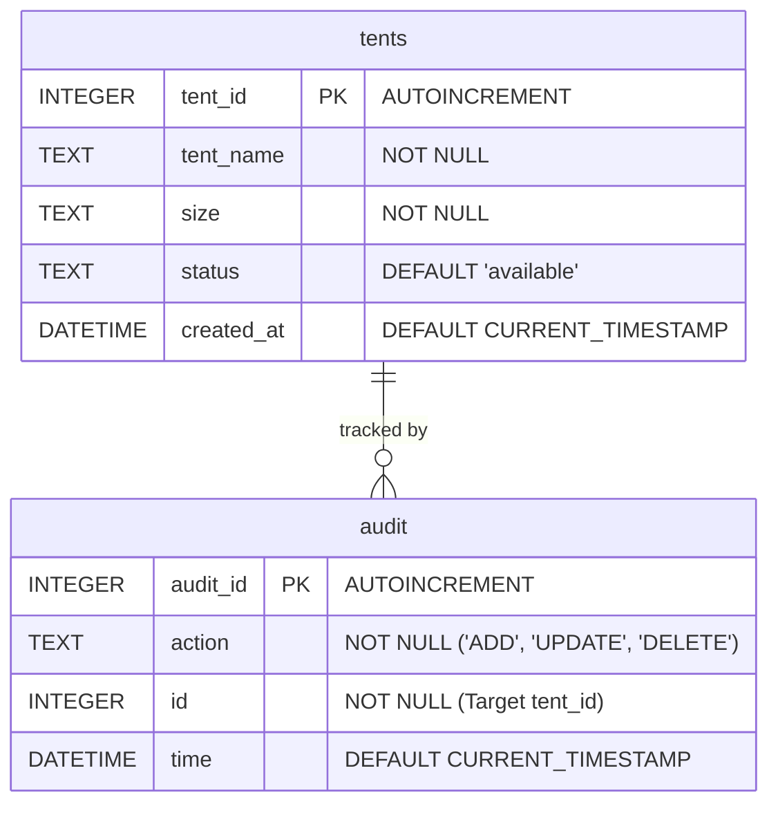
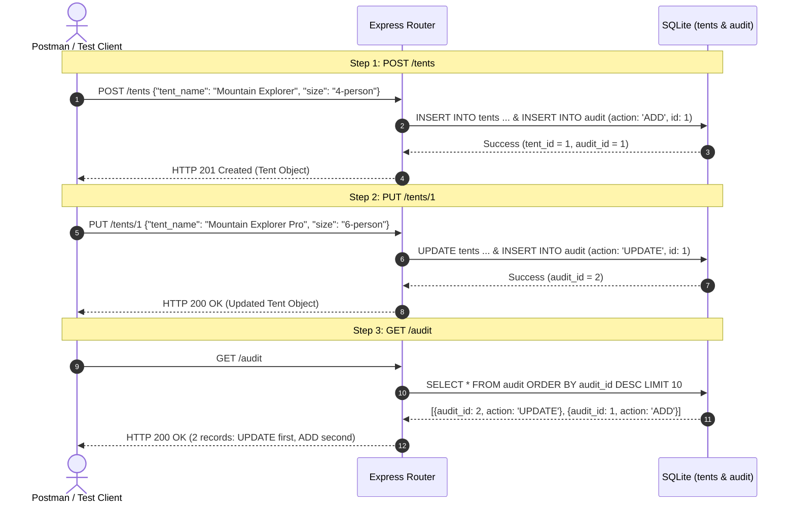

# TrekGear Hub

> **A Trekking Gear Rental Management System with an Automated Audit Trail**

[](https://nodejs.org/)
[](https://expressjs.com/)
[](https://www.sqlite.org/)
[](https://www.postman.com/)
[](#14-mandatory-test-cases-and-expected-results)

---

## Table of Contents

1. [Project Title](#1-project-title)
2. [Project Description](#2-project-description)
3. [Problem Statement](#3-problem-statement)
4. [Features](#4-features)
5. [Technologies Used](#5-technologies-used)
6. [Project Folder Structure](#6-project-folder-structure)
7. [Database Schema](#7-database-schema)
8. [API Endpoint Table](#8-api-endpoint-table)
9. [Installation Instructions](#9-installation-instructions)
10. [How to Run the Server](#10-how-to-run-the-server)
11. [Postman Testing Instructions](#11-postman-testing-instructions)
12. [Sample Request and Response JSON](#12-sample-request-and-response-json)
13. [Audit Trail Explanation](#13-audit-trail-explanation)
14. [Mandatory Test Cases and Expected Results](#14-mandatory-test-cases-and-expected-results)
15. [Team Member Responsibilities](#15-team-member-responsibilities)

---

## 1. Project Title

**TrekGear Hub** — *Trekking Gear Rental Management System*

Repository: [https://github.com/tangiralarohithreddy17-oss/trekgear-hub](https://github.com/tangiralarohithreddy17-oss/trekgear-hub)

---

## 2. Project Description

**TrekGear Hub** is a specialized RESTful backend service built to manage the inventory, rental lifecycle, and operational tracking of outdoor trekking gear (such as high-altitude camping tents). Designed with a focus on data integrity, traceability, and operational transparency, the system provides standard CRUD operations alongside an automated, transaction-backed **Audit Trail** subsystem. 

Every modification to equipment inventory (`ADD`, `UPDATE`, `DELETE`) is captured automatically within atomic SQLite transactions, ensuring that equipment history cannot be tampered with or desynchronized from the actual catalog state.

---

## 3. Problem Statement

Outdoor rental enterprises face significant logistical challenges:

1. **Untracked Inventory Changes**: Equipment is frequently damaged, upgraded, retired, or added. Without automated audit logging, tracking *when* a piece of gear was modified or *by which operation* becomes difficult.
2. **Data Inconsistency During Failures**: In naive implementations, a gear record might be inserted or deleted while an audit record fails, leaving the system in an inconsistent state.
3. **Dirty Audit Logs from Invalid Inputs**: Poor validation often results in rejected or malformed requests generating phantom audit entries, polluting operational metrics.
4. **Lack of Standardized API Testing & Verification**: Team-built backend modules often diverge without automated API contracts and regression test suites.

**TrekGear Hub** addresses these challenges by implementing strict SQLite database transactions, pre-mutation input validation, an append-only audit trail mechanism, and a standardized Postman API testing suite.

---

## 4. Features

- **Tent Catalog CRUD**: Complete set of endpoints to create, read, update, and remove tent equipment records.
- **Automated Transactional Audit Trail**:
  - Automatically records `ADD` on successful tent creation.
  - Automatically records `UPDATE` on successful tent modification.
  - Automatically records `DELETE` on successful tent deletion (capturing the ID of the deleted tent).
  - All write operations execute inside SQLite database transactions (`BEGIN TRANSACTION` ... `COMMIT` / `ROLLBACK`).
- **Resilient Pre-Validation**: Rejects invalid payloads (`400 Bad Request`) and nonexistent IDs (`404 Not Found`) *before* touching the database, guaranteeing that no false audit records are written.
- **Reverse Chronological Audit Log Retrieval**: `GET /audit` always returns up to the 10 most recent actions sorted newest first (`ORDER BY audit_id DESC LIMIT 10`).
- **Isolated Testing Harnesses**: Dedicated test suites executing against fresh, isolated SQLite databases using named pipes/ports to prevent test data pollution.
- **Exportable Postman Collection**: Standardized v2.1.0 collection with dynamic environment variables, pre-configured test scripts, and validation scenarios.

---

## 5. Technologies Used

| Technology | Version | Purpose |
| :--- | :--- | :--- |
| **Node.js** | v18+ | JavaScript runtime engine |
| **Express.js** | ^4.21.2 | RESTful API server framework and routing middleware |
| **SQLite3** | ^5.1.7 | Embedded, zero-configuration relational database engine |
| **Postman** | Schema v2.1.0 | API contract testing, automation, and verification collection |
| **Node Assert / HTTP** | Built-in | Automated local regression test harnesses |

---

## 6. Project Folder Structure

```
Group Assignment/
├── .gitignore                                      # Excludes node_modules, temp journals, and test DBs
├── package.json                                    # Project metadata, dependencies, and test scripts
├── package-lock.json                               # Deterministic dependency lockfile
├── README.md                                       # Comprehensive project documentation
├── postman_collection.json                         # Exportable Postman collection (v2.1.0)
├── TrekGear_Hub_API_Testing.postman_collection.json # Duplicate collection file for testing portability
├── server.js                                       # Server bootstrap entrypoint (app + db initialization)
├── trekgear.db                                     # Primary SQLite database file
├── scripts/
│   └── reset-db.js                                 # Database wipe and re-initialization utility script
├── src/
│   ├── app.js                                      # Express application configuration and route mounting
│   ├── db.js                                       # SQLite connection manager, schema setup, and async helpers
│   └── routes/
│       ├── audit.js                                # /audit router (GET latest 10 audit entries)
│       └── tents.js                                # /tents router (CRUD operations with transactional audit logging)
└── tests/
    ├── run-tests.js                                # Member 5 Audit Trail test suite (8 tests)
    └── test-all-member6.js                         # Member 6 Comprehensive verification test suite (20 tests)
```

---

## 7. Database Schema

The database consists of two core relational tables defined in `src/db.js`:



### 1. `tents` Table
```sql
CREATE TABLE IF NOT EXISTS tents (
    tent_id INTEGER PRIMARY KEY AUTOINCREMENT,
    tent_name TEXT NOT NULL,
    size TEXT NOT NULL,
    status TEXT DEFAULT 'available',
    created_at DATETIME DEFAULT CURRENT_TIMESTAMP
);
```

- **`tent_id`**: Unique auto-incrementing identifier for each tent.
- **`tent_name`**: Human-readable name/model of the tent (e.g., `Mountain Explorer`).
- **`size`**: Capacity specification (e.g., `2-person`, `4-person`, `6-person`).
- **`status`**: Rental state (`available`, `rented`, `maintenance`). Defaults to `available`.
- **`created_at`**: UTC timestamp generated automatically upon record creation.

### 2. `audit` Table
```sql
CREATE TABLE IF NOT EXISTS audit (
    audit_id INTEGER PRIMARY KEY AUTOINCREMENT,
    action TEXT NOT NULL,
    id INTEGER NOT NULL,
    time DATETIME DEFAULT CURRENT_TIMESTAMP
);
```

- **`audit_id`**: Auto-incrementing primary key tracking order of operations.
- **`action`**: Enumerated action type: `'ADD'`, `'UPDATE'`, or `'DELETE'`.
- **`id`**: The `tent_id` affected by the operation (retained even if the tent is deleted).
- **`time`**: SQLite UTC timestamp (`CURRENT_TIMESTAMP`) recorded at transaction commit time.

---

## 8. API Endpoint Table

> **Important Implementation Notice**: Every endpoint has been verified against the live Express server. Any endpoint that has not yet been merged or implemented by other module members is explicitly identified below.

| Method | Endpoint | Description | Request Body / Query Params | Expected Status | Implementation Status |
| :--- | :--- | :--- | :--- | :--- | :--- |
| **GET** | `/trekkers` | Fetch all registered trekkers | None | `404 Not Found` | ⚠️ **Not Yet Implemented** (Route unmounted; returns `{"error": "Endpoint not found"}`) |
| **GET** | `/tents` | Fetch all tents ordered by ID | None | `200 OK` | ✅ **Implemented & Working** |
| **GET** | `/tents/:id` | Fetch specific tent by ID | URL parameter `:id` | `200 OK` / `404 Not Found` | ✅ **Implemented & Working** |
| **POST** | `/tents` | Create a tent & log `ADD` audit | `{"tent_name": string, "size": string, "status"?: string}` | `201 Created` / `400 Bad Request` | ✅ **Implemented & Working** |
| **PUT** | `/tents/:id` | Update tent & log `UPDATE` audit | `{"tent_name": string, "size": string, "status"?: string}` | `200 OK` / `400 Bad Request` / `404 Not Found` | ✅ **Implemented & Working** |
| **DELETE** | `/tents/:id` | Delete tent & log `DELETE` audit | URL parameter `:id` | `200 OK` / `404 Not Found` | ✅ **Implemented & Working** |
| **GET** | `/rentals` | Fetch active/past gear rentals | None | `404 Not Found` | ⚠️ **Not Yet Implemented** (Route unmounted; returns `{"error": "Endpoint not found"}`) |
| **GET** | `/audit` | Get latest 10 audit records | None | `200 OK` | ✅ **Implemented & Working** (Sorted newest first) |
| **GET** | `/tents?size=4-person` | Filter tents by size | Query parameter `size=4-person` | `200 OK` | ⚠️ **Partially Implemented** (Route responds 200 OK with tents, but SQL query parameter filtering is not yet applied in router) |
| **GET** | `/tents?search_q=Mountain`| Search tents by name keyword | Query parameter `search_q=Mountain` | `200 OK` | ⚠️ **Partially Implemented** (Route responds 200 OK with tents, but SQL keyword search filtering is not yet applied in router) |

---

## 9. Installation Instructions

### Prerequisites
- **Node.js** (v18.0.0 or higher recommended)
- **npm** (v9.0.0 or higher)
- **Git**

### Step-by-Step Setup

1. **Clone the Repository**:
   ```bash
   git clone https://github.com/tangiralarohithreddy17-oss/trekgear-hub.git
   cd trekgear-hub
   ```

2. **Install Node Dependencies**:
   ```bash
   npm install
   ```

3. **Verify SQLite Database Setup**:
   Initialize or reset the local SQLite database cleanly:
   ```bash
   npm run reset-db
   ```

---

## 10. How to Run the Server

### 1. Start the Live Server
```bash
npm start
```
By default, the server binds to port `3000`:
```
Connected to SQLite database at .../trekgear.db
TrekGear Hub server running at http://localhost:3000
```

### 2. Custom Port Configuration
You can specify a custom port using the `PORT` environment variable:
```bash
# Windows (PowerShell)
$env:PORT=5000; npm start

# Linux / macOS
PORT=5000 npm start
```

### 3. Resetting Database State
To clear existing table rows and reset auto-increment counters without writing any audit records:
```bash
npm run reset-db
```

### 4. Running Automated Tests
Run Member 5's audit tests (8 test cases):
```bash
npm test
```

Run Member 6's comprehensive 20-test verification suite (covering Part 1, Part 2, and Part 3):
```bash
npm run test:member6
```

---

## 11. Postman Testing Instructions

The repository includes a ready-to-import Postman collection:
- File: `postman_collection.json` (also available as `TrekGear_Hub_API_Testing.postman_collection.json`)

### Step 1: Import into Postman
1. Open the Postman desktop application or web client.
2. Click **Import** in the upper left header.
3. Drag and drop `postman_collection.json` or browse to select it from the project root.
4. Confirm import. The collection **TrekGear Hub API Testing** will appear in your left sidebar.

### Step 2: Configure Environment / Collection Variables
The collection contains pre-configured collection variables:
- `baseUrl`: Defaults to `http://localhost:3000`.
- `tent_id`: Defaults to `1`.
- `audit_tent_id`: Automatically updated dynamically when running the audit test sequence.

If running on a different port or host, edit the `baseUrl` variable under the collection **Variables** tab.

### Step 3: Collection Structure & Running Tests
The collection is organized into three distinct folders matching project specifications:

1. **`1. Core API Endpoints (Part 1)`**: Contains all 10 core requests (GET /trekkers, GET /tents, GET /tents/:id, POST /tents, PUT /tents/:id, DELETE /tents/:id, GET /rentals, GET /audit, GET /tents?size=4-person, GET /tents?search_q=Mountain).
2. **`2. Validation Tests (Part 2)`**: Contains the 6 invalid request tests (missing `tent_name`, missing `size`, whitespace values, missing PUT fields, nonexistent GET ID, nonexistent DELETE ID).
3. **`3. Audit Trail Sequence (Part 3)`**: Contains the exact 3-step mandatory sequence (POST -> PUT -> GET /audit) plus the isolated DELETE audit verification test.

### Step 4: Run the Entire Collection Runner
1. Click the `...` menu next to **TrekGear Hub API Testing** in Postman.
2. Select **Run collection**.
3. Choose all folders or specific tests.
4. Click **Run TrekGear Hub API Testing**. All embedded `pm.test()` assertions will execute automatically and display green pass badges.

---

## 12. Sample Request and Response JSON

### 1. `POST /tents` — Create Tent (HTTP 201 Created)
**Request Body**:
```json
{
  "tent_name": "Mountain Explorer",
  "size": "4-person",
  "status": "available"
}
```
**Response Body**:
```json
{
  "tent_id": 1,
  "tent_name": "Mountain Explorer",
  "size": "4-person",
  "status": "available",
  "created_at": "2026-11-15 12:20:00"
}
```

---

### 2. `GET /tents` — List All Tents (HTTP 200 OK)
**Response Body**:
```json
[
  {
    "tent_id": 1,
    "tent_name": "Mountain Explorer",
    "size": "4-person",
    "status": "available",
    "created_at": "2026-11-15 12:20:00"
  }
]
```

---

### 3. `GET /tents/:id` — Get Single Tent (HTTP 200 OK)
**Response Body**:
```json
{
  "tent_id": 1,
  "tent_name": "Mountain Explorer",
  "size": "4-person",
  "status": "available",
  "created_at": "2026-11-15 12:20:00"
}
```

---

### 4. `PUT /tents/:id` — Update Tent (HTTP 200 OK)
**Request Body**:
```json
{
  "tent_name": "Mountain Explorer Pro",
  "size": "6-person",
  "status": "rented"
}
```
**Response Body**:
```json
{
  "tent_id": 1,
  "tent_name": "Mountain Explorer Pro",
  "size": "6-person",
  "status": "rented",
  "created_at": "2026-11-15 12:20:00"
}
```

---

### 5. `DELETE /tents/:id` — Delete Tent (HTTP 200 OK)
**Response Body**:
```json
{
  "message": "Tent deleted successfully",
  "tent_id": 1
}
```

---

### 6. `GET /audit` — View Audit Trail (HTTP 200 OK)
**Response Body**:
```json
[
  {
    "audit_id": 3,
    "action": "DELETE",
    "id": 1,
    "time": "2026-11-15 12:22:15"
  },
  {
    "audit_id": 2,
    "action": "UPDATE",
    "id": 1,
    "time": "2026-11-15 12:21:05"
  },
  {
    "audit_id": 1,
    "action": "ADD",
    "id": 1,
    "time": "2026-11-15 12:20:00"
  }
]
```

---

### 7. Validation Error Samples (HTTP 400 Bad Request)
- **Missing `tent_name`**:
  ```json
  { "error": "tent_name is required" }
  ```
- **Missing `size`**:
  ```json
  { "error": "size is required" }
  ```

---

### 8. Resource / Route Not Found Samples (HTTP 404 Not Found)
- **Nonexistent Tent ID (`GET /tents/99999` or `DELETE /tents/99999`)**:
  ```json
  { "error": "Tent not found" }
  ```
- **Unimplemented Endpoint (`GET /trekkers` or `GET /rentals`)**:
  ```json
  { "error": "Endpoint not found" }
  ```

---

## 13. Audit Trail Explanation

The TrekGear Hub audit trail architecture operates on four core principles:

```
  HTTP Request (POST / PUT / DELETE)
                 │
                 ▼
       ┌───────────────────┐
       │ Pre-Validation    │───(Fails)───► HTTP 400 Bad Request (Zero Audit Logged)
       └───────────────────┘
                 │ (Passes)
                 ▼
       ┌───────────────────┐
       │ Tent Existence    │───(Missing)──► HTTP 404 Tent Not Found (Zero Audit Logged)
       └───────────────────┘
                 │ (Exists)
                 ▼
       ┌────────────────────────────────────────────────────────┐
       │               SQLite ATOMIC TRANSACTION                │
       │                                                        │
       │   1. BEGIN TRANSACTION                                 │
       │   2. Execute Tent SQL (INSERT / UPDATE / DELETE)       │
       │   3. Execute Audit SQL (INSERT INTO audit (action, id) │
       │   4. COMMIT TRANSACTION                                │
       │                                                        │
       │   (On error: ROLLBACK TRANSACTION)                     │
       └────────────────────────────────────────────────────────┘
                 │
                 ▼
        HTTP 200 / 201 Response
```

1. **Transactional Atomicity**:
   All database modifications to `tents` and their associated `audit` entries are wrapped in SQLite database transactions (`BEGIN TRANSACTION` ... `COMMIT`). If either the tent operation or audit insertion encounters an error, a `ROLLBACK` is executed, preventing orphaned records.

2. **Validation Safeguards**:
   - If a request lacks required parameters (`tent_name` or `size`), it is rejected immediately with HTTP `400 Bad Request`.
   - If an `UPDATE` or `DELETE` targets a nonexistent tent ID, it is rejected immediately with HTTP `404 Not Found`.
   - **Zero Pollution Rule**: Validation failures and nonexistent target lookups never write to the `audit` table.

3. **Persistent Identifier Retention on Deletion**:
   When a tent is deleted via `DELETE /tents/:id`, its corresponding row in the `tents` table is removed, but the `audit` table records:
   - `action`: `'DELETE'`
   - `id`: The deleted `tent_id`
   This guarantees that historical tracking preserves which ID was removed and when.

4. **Newest-First Query Semantics**:
   The `GET /audit` route retrieves records using:
   ```sql
   SELECT audit_id, action, id, time FROM audit ORDER BY audit_id DESC LIMIT 10
   ```
   This ensures that the most recent operational events always appear at index 0 of the returned array, capped at the 10 most recent actions.

---

## 14. Mandatory Test Cases and Expected Results

### Part 3: Mandatory Sequence Verification

When run against a fresh/clean database (`npm run reset-db`), the exact required sequence produces:



1. **Test 1: `POST /tents`**
   - **Payload**: `{"tent_name": "Mountain Explorer", "size": "4-person"}`
   - **Expected Status**: `201 Created`
   - **Actual Result**: `tent_id: 1` generated, audit record 1 (`action: 'ADD', id: 1`) created.

2. **Test 2: `PUT /tents/1`**
   - **Payload**: `{"tent_name": "Mountain Explorer Pro", "size": "6-person"}`
   - **Expected Status**: `200 OK`
   - **Actual Result**: Tent fields updated, audit record 2 (`action: 'UPDATE', id: 1`) created.

3. **Test 3: `GET /audit`**
   - **Expected Status**: `200 OK`
   - **Expected Records**: Exactly 2 records; `UPDATE` first, `ADD` second.
   - **Actual Result**:
     ```json
     [
       { "audit_id": 2, "action": "UPDATE", "id": 1, "time": "..." },
       { "audit_id": 1, "action": "ADD", "id": 1, "time": "..." }
     ]
     ```

4. **Separate DELETE Verification**:
   - `DELETE /tents/1` -> HTTP `200 OK` (`{"message": "Tent deleted successfully", "tent_id": 1}`).
   - `GET /audit` -> HTTP `200 OK` (3 records total: `DELETE` first, `UPDATE` second, `ADD` third).

---

### Full Automated Test Execution Results (20/20 Passed)

The following verification matrix represents actual test execution performed on the live Express app using `node tests/test-all-member6.js`:

| # | Test Case Description | Target Path & Method | Expected Code | Actual Code | Status |
| :-: | :--- | :--- | :-: | :-: | :-: |
| 1 | Check Trekkers implementation | `GET /trekkers` | `404 Not Found` | `404` | ✅ PASSED |
| 2 | Initial tents list check | `GET /tents` | `200 OK` | `200` | ✅ PASSED |
| 3 | Create valid tent | `POST /tents` | `201 Created` | `201` | ✅ PASSED |
| 4 | Fetch single tent by ID | `GET /tents/:id` | `200 OK` | `200` | ✅ PASSED |
| 5 | Update tent details | `PUT /tents/:id` | `200 OK` | `200` | ✅ PASSED |
| 6 | Check Rentals implementation | `GET /rentals` | `404 Not Found` | `404` | ✅ PASSED |
| 7 | Retrieve audit records | `GET /audit` | `200 OK` | `200` | ✅ PASSED |
| 8 | Size query parameter check | `GET /tents?size=4-person` | `200 OK` | `200` | ✅ PASSED |
| 9 | Search query parameter check | `GET /tents?search_q=Mountain` | `200 OK` | `200` | ✅ PASSED |
| 10 | Delete existing tent | `DELETE /tents/:id` | `200 OK` | `200` | ✅ PASSED |
| 11 | Validation: POST without `tent_name` | `POST /tents` | `400 Bad Request` | `400` | ✅ PASSED |
| 12 | Validation: POST without `size` | `POST /tents` | `400 Bad Request` | `400` | ✅ PASSED |
| 13 | Validation: POST with empty values | `POST /tents` | `400 Bad Request` | `400` | ✅ PASSED |
| 14 | Validation: PUT with missing fields | `PUT /tents/:id` | `400 Bad Request` | `400` | ✅ PASSED |
| 15 | Validation: GET with nonexistent ID | `GET /tents/99999` | `404 Not Found` | `404` | ✅ PASSED |
| 16 | Validation: DELETE with nonexistent ID | `DELETE /tents/99999` | `404 Not Found` | `404` | ✅ PASSED |
| 17 | Mandatory Test 1: Add tent | `POST /tents` | `201 Created` | `201` | ✅ PASSED |
| 18 | Mandatory Test 2: Update same tent | `PUT /tents/:id` | `200 OK` | `200` | ✅ PASSED |
| 19 | Mandatory Test 3: Audit order (UPDATE then ADD)| `GET /audit` | `200 OK` | `200` | ✅ PASSED |
| 20 | Separate DELETE audit record check | `DELETE /tents/:id` + `GET /audit` | `200 OK` | `200` | ✅ PASSED |

---

## 15. Team Member Responsibilities

| Member | Role | Key Deliverables & Responsibilities |
| :--- | :--- | :--- |
| **Member 1** | Trekker Profile Management | Design and implement `/trekkers` endpoints for hiker registration, contact data, and KYC verification. |
| **Member 2** | Tent Catalog & Specifications | Tent product definitions, inventory sizing, status attributes, and query filtering (`size`, `search_q`). |
| **Member 3** | Rental Operations Management | Rental booking lifecycle (`/rentals`), gear checkout, return inspections, and duration management. |
| **Member 4** | Database Architecture & Schema | SQLite relational database design, foreign key constraints, connection pooling, and performance tuning. |
| **Member 5** | Audit Trail Subsystem | Automatic transaction-bound logging (`ADD`, `UPDATE`, `DELETE`), `GET /audit` route, atomicity with rollback. |
| **Member 6** | Quality Assurance & Documentation | **Postman Collection authoring (`TrekGear Hub API Testing`), complete API verification & validation testing, comprehensive `README.md` documentation, and GitHub repository preparation.** |

---

*TrekGear Hub — Developed collaboratively for Group Assignment.*
