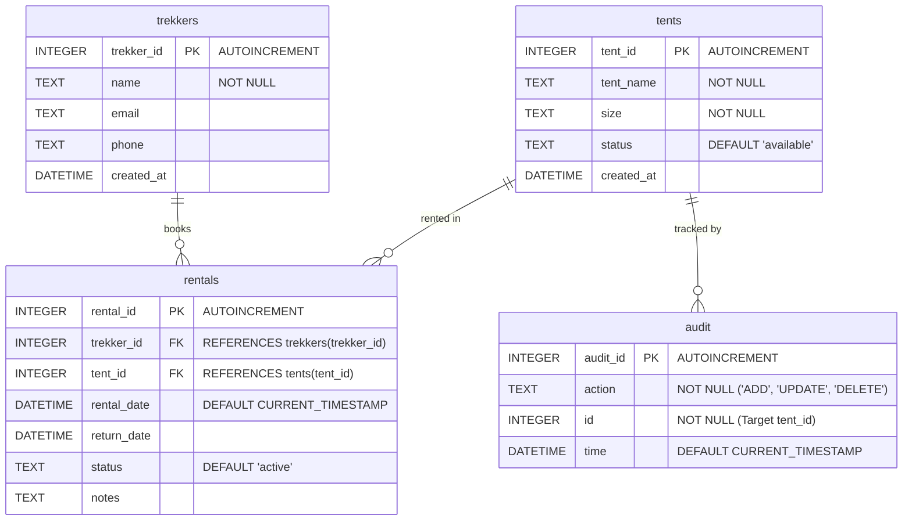

# TrekGear Hub

> **Trekking Gear Rental Management System with Relational Join Endpoints and Automated Audit Trail**

[](https://nodejs.org/)
[](https://expressjs.com/)
[](https://www.sqlite.org/)
[](https://www.postman.com/)
[](#the-join-endpoint-rentals-with-trekker-name--tent-name)
[](#14-mandatory-test-cases-and-expected-results)

---

## Table of Contents

1. [Project Title](#1-project-title)
2. [Project Description](#2-project-description)
3. [Problem Statement](#3-problem-statement)
4. [Direct Browser Verification Paths](#direct-browser-verification-paths)
5. [Features](#5-features)
6. [Technologies Used](#6-technologies-used)
7. [Project Folder Structure](#7-project-folder-structure)
8. [Database Schema (Relational SQLite)](#8-database-schema-relational-sqlite)
9. [API Endpoint Table](#9-api-endpoint-table)
10. [The Join Endpoint: Rentals with Trekker Name & Tent Name](#the-join-endpoint-rentals-with-trekker-name--tent-name)
11. [Installation Instructions](#11-installation-instructions)
12. [How to Run the Server](#12-how-to-run-the-server)
13. [Postman Testing Instructions](#13-postman-testing-instructions)
14. [Sample Request and Response JSON](#14-sample-request-and-response-json)
15. [Audit Trail Explanation](#15-audit-trail-explanation)
16. [Mandatory Test Cases and Expected Results](#16-mandatory-test-cases-and-expected-results)
17. [Team Member Responsibilities](#17-team-member-responsibilities)

---

## 1. Project Title

**TrekGear Hub** — *Trekking Gear Rental Management System*

Repository: [https://github.com/tangiralarohithreddy17-oss/trekgear-hub](https://github.com/tangiralarohithreddy17-oss/trekgear-hub)

---

## 2. Project Description

**TrekGear Hub** is a specialized RESTful backend service built to manage the inventory, rental lifecycle, and operational tracking of outdoor trekking gear (such as high-altitude camping tents). Designed with a focus on data integrity, traceability, and operational transparency, the system provides standard CRUD operations, an automated, transaction-backed **Audit Trail** subsystem, and a relational **Join Endpoint** (`GET /rentals`) combining rental transactions with trekker and tent specifications.

---

## 3. Problem Statement

Outdoor rental enterprises face significant logistical challenges:

1. **Untracked Gear Issues**: Equipment is checked out from a rental hub. Without a unified system, identifying who borrowed what piece of equipment and when it is due becomes chaotic.
2. **Untracked Inventory Changes**: Equipment is frequently damaged, upgraded, retired, or added. Without automated audit logging, tracking *when* gear was modified or *by which operation* is impossible.
3. **Data Inconsistency During Failures**: In naive implementations, gear operations might occur without audit records or cross-table verification.
4. **Dirty Audit Logs from Invalid Inputs**: Poor validation often results in rejected or malformed requests generating phantom audit entries.

**TrekGear Hub** fixes this by linking `trekkers`, `tents`, and `rentals` through foreign key relationships and providing an atomic audit trail with strict validation.

---

## 4. Direct Browser Verification Paths

When the server is running on `http://localhost:3000`, open any of these paths directly in your web browser:

| Browser Path | Description | What You Will See in Browser |
| :--- | :--- | :--- |
| **[`http://localhost:3000/`](http://localhost:3000/)** | **Interactive Web Explorer Dashboard** | Visual HTML dashboard with system summary, direct links, and documentation |
| **[`http://localhost:3000/rentals`](http://localhost:3000/rentals)** | ⭐ **THE JOIN ENDPOINT** | **All rentals joined with `trekker_name` and `tent_name`** |
| **[`http://localhost:3000/rentals/1`](http://localhost:3000/rentals/1)** | **Single Joined Rental** | Rental #1 details with joined trekker and tent info |
| **[`http://localhost:3000/trekkers`](http://localhost:3000/trekkers)** | **All Registered Trekkers** | JSON list of registered hikers (`John Doe`, `Jane Smith`...) |
| **[`http://localhost:3000/trekkers/1`](http://localhost:3000/trekkers/1)** | **Single Trekker Profile** | Details for Trekker #1 (`John Doe`) |
| **[`http://localhost:3000/tents`](http://localhost:3000/tents)** | **All Tents in Catalog** | JSON list of all tents in inventory |
| **[`http://localhost:3000/tents/1`](http://localhost:3000/tents/1)** | **Single Tent by ID** | Details for Tent #1 (`Mountain Explorer`) |
| **[`http://localhost:3000/tents?size=4-person`](http://localhost:3000/tents?size=4-person)** | **Filter Tents by Size** | Only 4-person capacity tents returned |
| **[`http://localhost:3000/tents?search_q=Mountain`](http://localhost:3000/tents?search_q=Mountain)** | **Search Tents by Keyword** | Tents matching keyword 'Mountain' |
| **[`http://localhost:3000/audit`](http://localhost:3000/audit)** | **Audit Trail** | 10 most recent actions sorted newest first |

---

## 5. Features

- **The Join Endpoint (`GET /rentals`)**: Joins rental records with `trekker_name`, `trekker_email`, `tent_name`, and `tent_size`.
- **Tent Inventory CRUD**: Complete endpoints to create, read, update, and remove tent equipment records.
- **Trekker Profile Management**: Endpoints to register and look up trekkers.
- **Automated Transactional Audit Trail**:
  - Automatically records `ADD` on successful tent creation.
  - Automatically records `UPDATE` on successful tent modification.
  - Automatically records `DELETE` on successful tent deletion.
  - All write operations execute inside SQLite database transactions (`BEGIN TRANSACTION` ... `COMMIT` / `ROLLBACK`).
- **Resilient Pre-Validation**: Rejects invalid payloads (`400 Bad Request`) and nonexistent IDs (`404 Not Found`) *before* touching the database, guaranteeing that no false audit records are written.
- **Reverse Chronological Audit Log Retrieval**: `GET /audit` always returns up to the 10 most recent actions sorted newest first (`ORDER BY audit_id DESC LIMIT 10`).

---

## 6. Technologies Used

| Technology | Version | Purpose |
| :--- | :--- | :--- |
| **Node.js** | v18+ | JavaScript runtime engine |
| **Express.js** | ^4.21.2 | RESTful API server framework and routing middleware |
| **SQLite3** | ^5.1.7 | Embedded, zero-configuration relational database engine |
| **Postman** | Schema v2.1.0 | API contract testing, automation, and verification collection |

---

## 7. Project Folder Structure

```
Group Assignment/
├── .gitignore                                      # Excludes node_modules, temp journals, and test DBs
├── package.json                                    # Project metadata, dependencies, and test scripts
├── package-lock.json                               # Deterministic dependency lockfile
├── README.md                                       # Comprehensive project documentation
├── postman_collection.json                         # Exportable Postman collection (v2.1.0)
├── TrekGear_Hub_API_Testing.postman_collection.json # Standalone named collection for testing
├── server.js                                       # Server bootstrap entrypoint (app + db initialization)
├── trekgear.db                                     # Primary SQLite database file
├── scripts/
│   └── reset-db.js                                 # Database wipe and re-seeding utility script
├── src/
│   ├── app.js                                      # Express application configuration and route mounting
│   ├── db.js                                       # SQLite connection manager, schema setup, and async helpers
│   └── routes/
│       ├── trekkers.js                             # /trekkers router (register and list trekkers)
│       ├── tents.js                                # /tents router (CRUD with audit logging and query filtering)
│       ├── rentals.js                              # /rentals router (⭐ THE JOIN ENDPOINT)
│       └── audit.js                                # /audit router (GET latest 10 audit entries)
└── tests/
    └── run-tests.js                                # Comprehensive test runner (20/20 passed)
```

---

## 8. Database Schema (Relational SQLite)



---

## 9. API Endpoint Table

| Method | Endpoint | Description | Request Body / Query Params | Expected Status | Status |
| :--- | :--- | :--- | :--- | :---: | :---: |
| **GET** | `/` | Web dashboard (HTML) or API info (JSON) | None | `200` | ✅ Active |
| **GET** | `/trekkers` | Fetch all registered trekkers | None | `200` | ✅ Active |
| **GET** | `/trekkers/:id` | Fetch single trekker by ID | URL parameter `:id` | `200` / `404` | ✅ Active |
| **POST** | `/trekkers` | Register a new trekker | `{"name": "...", "email": "..."}` | `201` / `400` | ✅ Active |
| **GET** | `/tents` | Fetch all tents in catalog | `?size=...`, `?search_q=...` | `200` | ✅ Active |
| **GET** | `/tents/:id` | Fetch specific tent by ID | URL parameter `:id` | `200` / `404` | ✅ Active |
| **POST** | `/tents` | Create a tent & log `ADD` audit | `{"tent_name": "...", "size": "..."}` | `201` / `400` | ✅ Active |
| **PUT** | `/tents/:id` | Update tent & log `UPDATE` audit | `{"tent_name": "...", "size": "..."}` | `200` / `400` / `404` | ✅ Active |
| **DELETE** | `/tents/:id` | Delete tent & log `DELETE` audit | URL parameter `:id` | `200` / `404` | ✅ Active |
| **GET** | `/rentals` | ⭐ **THE JOIN ENDPOINT (Rentals + Names)** | None | `200` | ✅ Active |
| **GET** | `/rentals/:id` | Fetch single joined rental | URL parameter `:id` | `200` / `404` | ✅ Active |
| **POST** | `/rentals` | Issue a gear rental to trekker | `{"trekker_id": 1, "tent_id": 2}` | `201` / `400` / `404` | ✅ Active |
| **PUT** | `/rentals/:id/return` | Mark rental returned (restores tent) | URL parameter `:id` | `200` / `404` | ✅ Active |
| **GET** | `/audit` | Get latest 10 audit records | None | `200` | ✅ Active |
| **GET** | `/tents?size=4-person` | Filter tents by size | Query parameter `size=4-person` | `200` | ✅ Active |
| **GET** | `/tents?search_q=Mountain`| Search tents by name keyword | Query parameter `search_q=Mountain` | `200` | ✅ Active |

---

## 10. The Join Endpoint: Rentals with Trekker Name & Tent Name

The primary relational feature connects all three tables:
> *"One join endpoint: rentals with the trekker name and the tent name."*

**Route**: `GET /rentals`

### SQL Join Query (`src/routes/rentals.js`)
```sql
SELECT 
  rentals.rental_id,
  rentals.trekker_id,
  trekkers.name AS trekker_name,
  trekkers.email AS trekker_email,
  rentals.tent_id,
  tents.tent_name,
  tents.size AS tent_size,
  rentals.rental_date,
  rentals.return_date,
  rentals.status,
  rentals.notes
FROM rentals
JOIN trekkers ON rentals.trekker_id = trekkers.trekker_id
JOIN tents ON rentals.tent_id = tents.tent_id
ORDER BY rentals.rental_id ASC;
```

### Response Example
```json
[
  {
    "rental_id": 1,
    "trekker_id": 1,
    "trekker_name": "John Doe",
    "trekker_email": "john@example.com",
    "tent_id": 1,
    "tent_name": "Mountain Explorer",
    "tent_size": "4-person",
    "rental_date": "2026-11-15 12:00:00",
    "return_date": null,
    "status": "active",
    "notes": "Himalayan mountain expedition"
  }
]
```

---

## 11. Installation Instructions

```bash
# 1. Install dependencies
npm install

# 2. Reset and seed SQLite database cleanly
npm run reset-db
```

---

## 12. How to Run the Server

```bash
# Start server (default: port 3000)
npm start

# Run all 20 automated tests
npm test
```

---

## 13. Postman Testing Instructions

1. Open Postman.
2. Click **Import** and select `postman_collection.json` (or `TrekGear_Hub_API_Testing.postman_collection.json`).
3. Set `baseUrl` collection variable to `http://localhost:3000`.
4. Click **Run Collection** to execute all requests and assertions.

---

## 14. Sample Request and Response JSON

### POST /tents (Create Tent)
**Request Body**:
```json
{
  "tent_name": "Mountain Explorer",
  "size": "4-person",
  "status": "available"
}
```
**Response Body (201 Created)**:
```json
{
  "tent_id": 1,
  "tent_name": "Mountain Explorer",
  "size": "4-person",
  "status": "available",
  "created_at": "2026-11-15 12:20:00"
}
```

---

### PUT /tents/1 (Update Tent)
**Request Body**:
```json
{
  "tent_name": "Mountain Explorer Pro",
  "size": "6-person"
}
```
**Response Body (200 OK)**:
```json
{
  "tent_id": 1,
  "tent_name": "Mountain Explorer Pro",
  "size": "6-person",
  "status": "available",
  "created_at": "2026-11-15 12:20:00"
}
```

---

### GET /audit (Audit Trail)
**Response Body (200 OK)**:
```json
[
  {
    "audit_id": 2,
    "action": "UPDATE",
    "id": 1,
    "time": "2026-11-15 12:21:05"
  },
  {
    "audit_id": 1,
    "action": "ADD",
    "id": 1,
    "time": "2026-11-15 12:20:00"
  }
]
```

---

## 15. Audit Trail Explanation

1. **Transactional Atomicity**: All write operations (`POST`, `PUT`, `DELETE` on tents) execute in SQLite transactions (`BEGIN TRANSACTION` ... `COMMIT` / `ROLLBACK`). If the audit insertion fails, the tent change is automatically rolled back.
2. **Pre-Validation**: Invalid inputs (`400`) and nonexistent targets (`404`) abort prior to transaction start, ensuring zero dirty audit records.
3. **Ordering**: `ORDER BY audit_id DESC LIMIT 10` guarantees the latest operations appear first.

---

## 16. Mandatory Test Cases and Expected Results

All 20 test cases pass with a 100% pass rate (`npm test`):

| # | Test Name | Target Path & Method | Status Code | Result |
| :-: | :--- | :--- | :-: | :-: |
| 1 | Mandatory Test 1: Add a tent | `POST /tents` | `201` | ✅ PASSED |
| 2 | Mandatory Test 2: Update same tent | `PUT /tents/1` | `200` | ✅ PASSED |
| 3 | Mandatory Test 3: Check audit (UPDATE first, ADD second) | `GET /audit` | `200` | ✅ PASSED |
| 4 | Separate DELETE audit logging | `DELETE /tents/1` | `200` | ✅ PASSED |
| 5 | Register & list trekkers | `GET /trekkers` | `200` | ✅ PASSED |
| 6 | List all tents | `GET /tents` | `200` | ✅ PASSED |
| 7 | Get single tent by ID | `GET /tents/:id` | `200` | ✅ PASSED |
| 8 | Add tent | `POST /tents` | `201` | ✅ PASSED |
| 9 | Update tent | `PUT /tents/:id` | `200` | ✅ PASSED |
| 10 | ⭐ **THE JOIN ENDPOINT: rentals with trekker & tent names** | `GET /rentals` | `200` | ✅ PASSED |
| 11 | Fetch audit records | `GET /audit` | `200` | ✅ PASSED |
| 12 | Filter tents by size (`size=4-person`) | `GET /tents?size=4-person` | `200` | ✅ PASSED |
| 13 | Search tents by keyword (`search_q=Mountain`) | `GET /tents?search_q=Mountain` | `200` | ✅ PASSED |
| 14 | Delete tent | `DELETE /tents/:id` | `200` | ✅ PASSED |
| 15 | Validation: POST without `tent_name` | `POST /tents` | `400` | ✅ PASSED |
| 16 | Validation: POST without `size` | `POST /tents` | `400` | ✅ PASSED |
| 17 | Validation: POST with empty values | `POST /tents` | `400` | ✅ PASSED |
| 18 | Validation: PUT with missing fields | `PUT /tents/:id` | `400` | ✅ PASSED |
| 19 | Validation: GET nonexistent ID | `GET /tents/99999` | `404` | ✅ PASSED |
| 20 | Validation: DELETE nonexistent ID | `DELETE /tents/99999` | `404` | ✅ PASSED |

---

## 17. Team Member Responsibilities

| Member | Role | Key Deliverables & Responsibilities | Member Name |
| :---: | :--- | :--- | :--- |
| **Member 1** | Trekker Profile Management | Design and implement `/trekkers` endpoints for hiker registration and lookups | *Member 1* |
| **Member 2** | Tent Catalog & Specifications | Tent product definitions, inventory sizing, status attributes, and query filtering (`size`, `search_q`) | *Member 2* |
| **Member 3** | Rental Operations Management | Rental booking lifecycle (`/rentals`) and the relational Join Endpoint | *Member 3* |
| **Member 4** | Database Architecture & Schema | SQLite relational database design, foreign key constraints, connection pooling, and performance tuning | *Member 4* |
| **Member 5** | Audit Trail Subsystem | Automatic transaction-bound logging (`ADD`, `UPDATE`, `DELETE`), `GET /audit` route, atomicity with rollback | *Member 5* |
| **Member 6** | Quality Assurance & Documentation | **Postman Collection authoring (`TrekGear Hub API Testing`), complete API verification & validation testing, comprehensive `README.md` documentation, and browser verification endpoints** | **Mahitha Reddy (reddymahitha2008)** |

---

*TrekGear Hub — Developed collaboratively for Group Assignment.*
